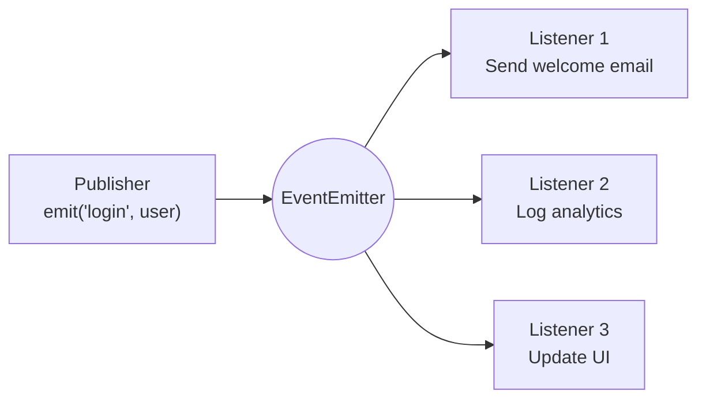
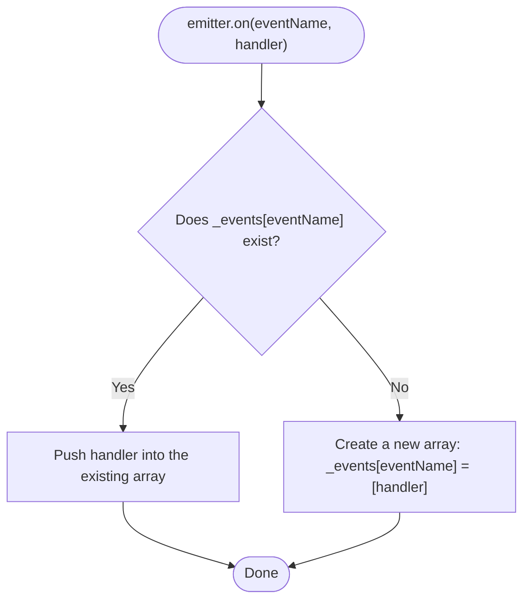
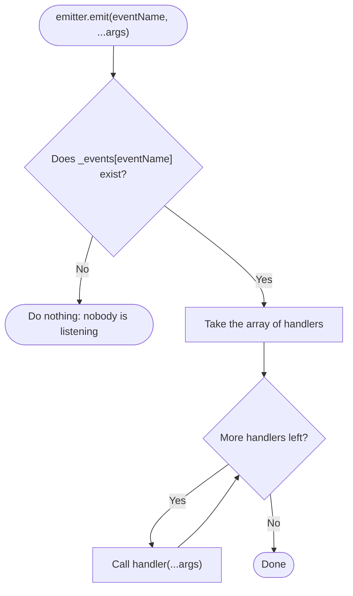
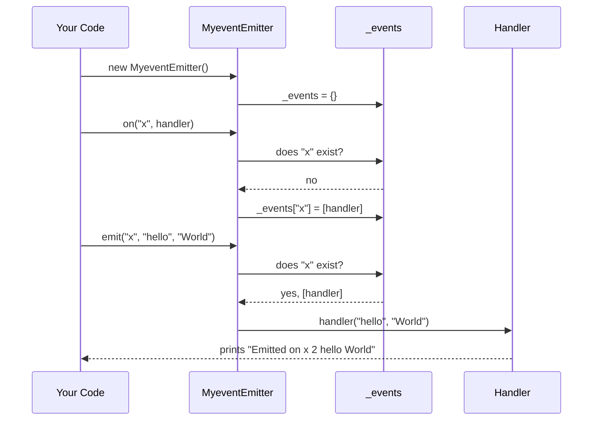
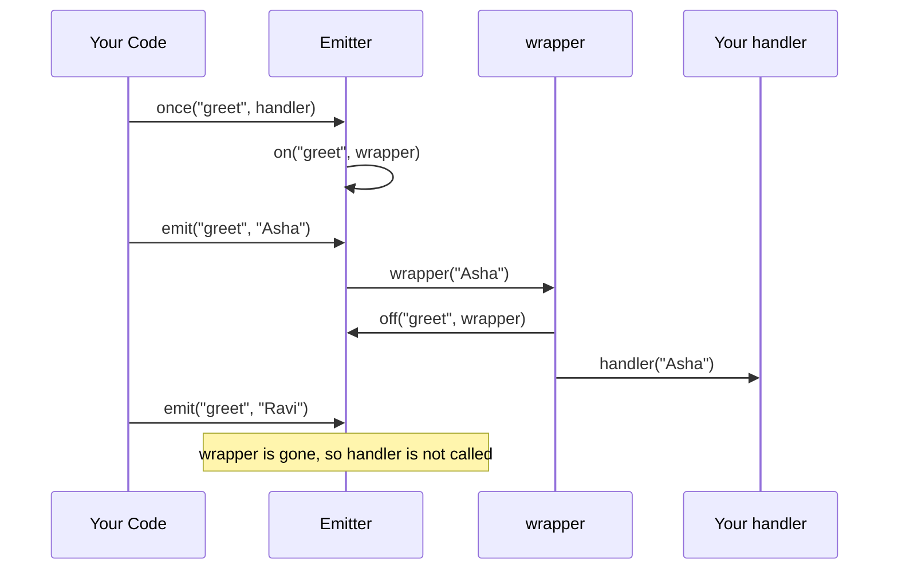

# MyEventEmitter


A from-scratch implementation of the **Event Emitter** (Publish–Subscribe) pattern in plain JavaScript, with **zero dependencies**.

It is built for **learning**: the core is about 20 lines, every part is explained, and the README includes diagrams and interview questions so you can revise quickly.

---

## Table of Contents

- [Overview](#overview)
- [Features](#features)
- [Getting Started](#getting-started)
- [Usage](#usage)
- [API Reference](#api-reference)
- [How It Works](#how-it-works)
- [The Original Code, Explained](#the-original-code-explained)
- [Simple Version (Start Here)](#simple-version-start-here)
- [Advanced Version](#advanced-version)
- [Comparison with Node.js EventEmitter](#comparison-with-nodejs-eventemitter)
- [Complexity](#complexity)
- [Common Pitfalls](#common-pitfalls)
- [Testing](#testing)
- [Interview Questions](#interview-questions)
- [Practice Exercises](#practice-exercises)
- [Project Structure](#project-structure)
- [Contributing](#contributing)
- [License](#license)

---

## Overview

An **event emitter** lets different parts of a program talk to each other **without knowing about each other**.

- Code that is interested in something **subscribes** with `on`.
- Code that notices something happened **publishes** with `emit`.
- The emitter sits in the middle and calls every subscriber.

**Analogy:** a YouTube channel. Subscribing is `on`, uploading a video is `emit`, and every subscriber gets notified. The creator never needs to know who the subscribers are.

| YouTube | Event Emitter |
|---|---|
| Channel / topic | Event name, e.g. `"x"` |
| Click **Subscribe** | `emitter.on("x", handler)` |
| Creator uploads a video | `emitter.emit("x", data)` |
| Subscribers are notified | Every handler is called with `data` |



**Where this pattern is used:** Node.js streams and HTTP servers, DOM `addEventListener`, Socket.IO, and state-management libraries.

## Features

- `on` – subscribe to an event
- `emit` – trigger an event and pass any number of arguments
- `off` – unsubscribe
- `once` – listen a single time *(advanced version)*
- Method chaining and a return value for `emit` *(advanced version)*
- No dependencies, easy to read, with a test suite

## Getting Started

### Prerequisites

[Node.js](https://nodejs.org/) **14 or newer**.

### Installation

```bash
git clone https://github.com/<your-username>/<your-repo>.git
cd <your-repo>
```

### Run

```bash
npm start          # runs the simple example (on, off, emit)
npm run advanced   # runs the advanced example (adds once and chaining)
npm run original   # runs your original implementation
npm test           # runs all tests
```

## Usage

### Basic (original implementation)

📄 [`customEventEmitter.original.js`](./customEventEmitter.original.js)

```js
const emitter = new MyeventEmitter();

emitter.on('x', (arg1, arg2) => {
  console.log('Emitted on x 2  ', arg1, arg2);
});

emitter.emit('x', 'hello', 'World');
```

Output:

```text
Emitted on x 2   hello World
```

### Simple version (start here)

📄 [`customEventEmitter.js`](./customEventEmitter.js) · example: [`example.js`](./example.js)

```js
const MyEventEmitter = require('./customEventEmitter');

const emitter = new MyEventEmitter();

function sayHello(name) {
  console.log(`Hello, ${name}!`);
}

function sayWelcome(name) {
  console.log(`Welcome, ${name}!`);
}

emitter.on('greet', sayHello);     // subscribe
emitter.on('greet', sayWelcome);   // subscribe

emitter.emit('greet', 'Asha');     // both functions run

emitter.off('greet', sayHello);    // unsubscribe

emitter.emit('greet', 'Ravi');     // only sayWelcome runs
```

Output:

```text
Hello, Asha!
Welcome, Asha!
Welcome, Ravi!
```

### Advanced version

📄 [`customEventEmitter.advanced.js`](./customEventEmitter.advanced.js) · example: [`example.advanced.js`](./example.advanced.js)

```js
const MyEventEmitter = require('./customEventEmitter.advanced');

const emitter = new MyEventEmitter();

function greet(name) {
  console.log(`Hello, ${name}!`);
}

emitter.on('greet', greet);
emitter.once('greet', (name) => console.log(`(first time only) Welcome, ${name}`));

emitter.emit('greet', 'Asha');   // both listeners run
emitter.emit('greet', 'Ravi');   // only greet runs

emitter.off('greet', greet);
console.log(emitter.emit('greet', 'Nobody')); // false -> nobody is listening

// chaining
emitter
  .on('start', () => console.log('started'))
  .on('stop', () => console.log('stopped'));
```

Output:

```text
Hello, Asha!
(first time only) Welcome, Asha
Hello, Ravi!
false
```

## API Reference

| Method | Description | Simple | Advanced |
|---|---|:-:|:-:|
| `on(eventName, handler)` | Call `handler` whenever `eventName` is emitted. Handlers run in the order they were added. | ✅ | ✅ returns `this` |
| `off(eventName, handler)` | Stop calling `handler` for `eventName`. | ✅ | ✅ returns `this` |
| `emit(eventName, ...args)` | Call every handler of `eventName`, passing `...args` to each. | ✅ | ✅ returns `true` / `false` |
| `once(eventName, handler)` | Like `on`, but the handler is removed after its first call. | ❌ | ✅ returns `this` |

## How It Works

### The data structure


The whole emitter is an object that maps an **event name** to an **array of handler functions**:

```js
emitter._events = {
  x:     [handlerA, handlerB],
  login: [handlerC]
};
```

- `on` adds a function to the array.
- `emit` loops through the array and calls each function.
- Finding an event by name is a hash lookup, so it is fast.

### Flow of `on()`



### Flow of `emit()`



### Full program sequence



### Step-by-step state

| # | Line executed | `_events` after it | What happens |
|---|---|---|---|
| 1 | `new MyeventEmitter()` | `{}` | The constructor creates an empty registry. |
| 2 | `emitter.on('x', fn)` | `{ x: [fn] }` | `"x"` did not exist, so a new array `[fn]` is created. |
| 3 | `emitter.emit('x', 'hello', 'World')` | `{ x: [fn] }` | `args = ['hello', 'World']`, and the loop starts. |
| 4 | `fn(...args)` | `{ x: [fn] }` | `arg1 = 'hello'`, `arg2 = 'World'`, and it prints. |
| 5 | Loop ends | `{ x: [fn] }` | `emit` does not remove handlers. |

## The Original Code, Explained

📄 [`customEventEmitter.original.js`](./customEventEmitter.original.js)

### 1. Class and constructor

```js
class MyeventEmitter {
    constructor(){
        this._events = {};
    }
```

`this._events` is the registry described above. It starts empty. The leading underscore is a convention meaning "internal, do not touch from outside".

### 2. `on` – subscribe

```js
on(eventName , handler)
{
    if(this._events[eventName]){
        this._events[eventName].push(handler);
    }else{
        this._events[eventName] = [handler];
    }
}
```

- If the event **already has listeners**, the existing array is truthy, so the new handler is pushed onto it.
- If it is the **first listener**, the lookup gives `undefined`, so a new array `[handler]` is created.
- Many handlers can listen to the same event, and they are stored in the order they were added.

### 3. `emit` – publish

```js
emit(eventName , ...args){
    if(this._events[eventName]){
        this._events[eventName]?.forEach((event) => {
            event(...args);
        });
    }
}
```

- `...args` (**rest parameter**) collects every argument after `eventName` into an array. `emit('x', 'hello', 'World')` gives `args = ['hello', 'World']`.
- `if (this._events[eventName])` means that if nobody is listening, nothing happens and no error is thrown.
- `forEach` visits each handler in order.
- `event(...args)` (**spread operator**) expands the array back into separate arguments, so the call becomes `event('hello', 'World')`.
- The `?.` is redundant, because the `if` above already guarantees the array exists. It is harmless.
- The callback parameter is called `event` but it is really a handler function, so `handler` would be a clearer name.

### 4. Using it

```js
const emitter = new MyeventEmitter();

emitter.on('x' , (arg1 , arg2) =>{
    console.log("Emitted on x 2  ", arg1 , arg2)
})
emitter.emit("x" , "hello" , "World");
```

1. Create an emitter.
2. Subscribe a function that takes two parameters to event `"x"`.
3. Emit `"x"` with two values. The emitter calls the function as `fn("hello", "World")`.

## Simple Version (Start Here)

📄 [`customEventEmitter.js`](./customEventEmitter.js)

Only three methods and no tricky parts. If you understand this file, you understand an event emitter.

```js
// A simple Event Emitter with 3 methods: on, off, emit.

class MyEventEmitter {
  constructor() {
    // The "notebook" of listeners. It looks like this:
    // { eventName: [function1, function2, ...] }
    this._events = {};
  }

  // on: "When this event happens, call my function."
  on(eventName, handler) {
    if (!this._events[eventName]) {
      this._events[eventName] = [];            // first time: make an empty list
    }
    this._events[eventName].push(handler);     // add the function to the list
  }

  // off: "Stop calling my function."
  off(eventName, handler) {
    if (!this._events[eventName]) return;      // nothing to remove

    // keep every function EXCEPT the one we want to remove
    this._events[eventName] = this._events[eventName].filter((fn) => fn !== handler);
  }

  // emit: "This event happened! Call everyone who is listening."
  emit(eventName, ...args) {
    if (!this._events[eventName]) return;      // nobody is listening

    this._events[eventName].forEach((handler) => handler(...args));
  }
}

module.exports = MyEventEmitter;
```

### The idea in one picture

The emitter keeps a **notebook**. Each page has an event name and a list of functions:

```js
{
  greet: [sayHello, sayWelcome],
  bye:   [sayGoodbye]
}
```

In JavaScript a function is a value, so it can be stored in a list and called later.

### Each method in plain words

| Method | In plain words | How it does it |
|---|---|---|
| `constructor` | Open an empty notebook | `this._events = {}` |
| `on` | "Call my function when this happens" | Find (or create) the list for the event, then `push` the function into it |
| `off` | "Stop calling my function" | `filter` the list so every function stays **except** the one to remove |
| `emit` | "It happened! Tell everyone" | Loop over the list and call each function with the arguments |

### Step by step

```js
const emitter = new MyEventEmitter();   // _events = {}
emitter.on('greet', sayHello);          // _events = { greet: [sayHello] }
emitter.on('greet', sayWelcome);        // _events = { greet: [sayHello, sayWelcome] }
emitter.emit('greet', 'Asha');          // calls sayHello('Asha'), then sayWelcome('Asha')
emitter.off('greet', sayHello);         // _events = { greet: [sayWelcome] }
emitter.emit('greet', 'Ravi');          // calls sayWelcome('Ravi')
```

### What changed from the original

| Change | Reason |
|---|---|
| Name fixed to `MyEventEmitter` | PascalCase is the standard for classes. |
| Callback variable renamed to `handler` | It is a function that handles the event, not an "event". |
| Redundant `?.` removed | The `if` check already guarantees the list exists. |
| `off()` added | Lets you unsubscribe, which prevents memory leaks. |
| `module.exports` | Makes the class importable from other files. |

## Advanced Version

📄 [`customEventEmitter.advanced.js`](./customEventEmitter.advanced.js)

Read this **after** the simple version. It adds `once`, chaining, and a return value for `emit`.

```js
// ADVANCED version: adds once(), chaining and a return value for emit().
// Beginners: start with customEventEmitter.js (the simple version) first.

class MyEventEmitter {
  constructor() {
    // Our "notebook" of listeners. It looks like this:
    // { eventName: [function1, function2, ...] }
    this._events = {};
  }

  // on: "When this event happens, call my function."
  on(eventName, handler) {
    // First listener for this event? Make an empty list for it.
    if (!this._events[eventName]) {
      this._events[eventName] = [];
    }

    // Add the function to the list.
    this._events[eventName].push(handler);

    // Return `this` so calls can be chained: emitter.on(...).on(...)
    return this;
  }

  // off: "Stop calling my function."
  off(eventName, handler) {
    const handlers = this._events[eventName];
    if (!handlers) return this; // nothing to remove

    // Keep every function EXCEPT the one we want to remove.
    this._events[eventName] = handlers.filter(
      (fn) => fn !== handler && fn.originalHandler !== handler
    );

    return this;
  }

  // once: "Call my function only the first time, then forget it."
  once(eventName, handler) {
    // A small function that wraps your function.
    const wrapper = (...args) => {
      this.off(eventName, wrapper); // 1. remove itself first
      handler(...args);             // 2. then call your real function
    };

    // Remember the real function, so off(eventName, handler) still works.
    wrapper.originalHandler = handler;

    return this.on(eventName, wrapper);
  }

  // emit: "This event happened! Tell everyone who is listening."
  emit(eventName, ...args) {
    const handlers = this._events[eventName];

    // Nobody is listening? Do nothing and say so.
    if (!handlers || handlers.length === 0) return false;

    // Loop over a COPY of the list, so removing a handler
    // during the loop (like once does) cannot skip anyone.
    [...handlers].forEach((handler) => handler(...args));

    return true; // at least one listener was called
  }
}

module.exports = MyEventEmitter;
```

### What the advanced version adds

| Addition | Reason |
|---|---|
| `once()` | Runs a handler a single time, then removes it. |
| `return this` in `on`, `off`, `once` | Allows chaining: `emitter.on(...).on(...)`. |
| `emit()` returns `true` or `false` | Matches Node.js: tells the caller whether anyone was listening. |
| `[...handlers]` in `emit()` | Loops over a copy, so a handler that removes itself cannot cause others to be skipped. |
| `originalHandler` | Lets `off(eventName, handler)` find a handler that `once` wrapped. |

### How `once()` works



## Comparison with Node.js EventEmitter

| Feature | Original | Simple | Advanced | Node.js `events` |
|---|:-:|:-:|:-:|:-:|
| `on` / `emit` | ✅ | ✅ | ✅ | ✅ |
| `off` | ❌ | ✅ | ✅ | ✅ |
| `once` | ❌ | ❌ | ✅ | ✅ |
| Chaining | ❌ | ❌ | ✅ | ✅ |
| `emit` returns boolean | ❌ | ❌ | ✅ | ✅ |
| `removeAllListeners` | ❌ | ❌ | ❌ | ✅ |
| `prependListener` | ❌ | ❌ | ❌ | ✅ |
| Special `'error'` event | ❌ | ❌ | ❌ | ✅ |
| Max-listener leak warning | ❌ | ❌ | ❌ | ✅ |

Node's built-in version, for reference:

```js
const EventEmitter = require('events');
const emitter = new EventEmitter();
emitter.on('x', (a, b) => console.log(a, b));
emitter.emit('x', 'hello', 'World');
```

## Complexity

With **n** listeners on one event:

| Operation | Time |
|---|---|
| `on` | O(1) |
| `emit` | O(n) |
| `off` | O(n) |
| `once` *(advanced)* | O(1) to register, O(n) to remove after firing |

Space is O(E + L), where E is the number of event names and L the total number of listeners.

## Common Pitfalls

1. **Anonymous functions cannot be removed.** `off('x', () => {})` creates a *new* function. Keep a reference:
   ```js
   const handler = () => {};
   emitter.on('x', handler);
   emitter.off('x', handler); // works
   ```
2. **Forgotten listeners leak memory.** Always call `off` when you are done.
3. **Handlers run synchronously, in order.** `emit` returns only after all handlers finish.
4. **An error in one handler stops the rest.** Wrap handler calls in `try/catch` if you need isolation.
5. **Typos fail silently.** `emit('logn')` does nothing. Use constants such as `const EVENTS = { LOGIN: 'login' }`.
6. **`{}` has inherited keys.** An event named `"constructor"` or `"toString"` can behave oddly. A `Map` or `Object.create(null)` avoids this.
7. **Naming:** class names should be PascalCase, so `MyEventEmitter` rather than `MyeventEmitter`.

## Testing

```bash
npm test
```

```text
  ✓ emit passes all arguments to the listener
  ✓ multiple listeners run in the order they were added
  ✓ emitting an event with no listeners does not throw
  ✓ off removes a listener
  ✓ off removes only the chosen listener
  ✓ different events do not affect each other

6/6 tests passed
  ✓ emit passes all arguments to the listener
  ✓ multiple listeners run in registration order
  ✓ emit returns false when nobody is listening
  ✓ emit returns true when at least one listener exists
  ✓ off removes a listener
  ✓ once runs only one time
  ✓ off can remove a listener registered with once
  ✓ methods are chainable
  ✓ removing a listener during emit does not skip the others

9/9 tests passed
```

[`test.js`](./test.js) tests the simple version and [`test.advanced.js`](./test.advanced.js) tests the advanced version. Both use only Node's built-in `assert`.

## Interview Questions

<details>
<summary><b>What is an Event Emitter?</b></summary>

An object that implements the pub/sub pattern. You register listeners for named events with `on` and trigger them with `emit`, which calls every listener with the given arguments.
</details>

<details>
<summary><b>What data structure is used internally, and why?</b></summary>

An object (or `Map`) from event name to an array of handlers. Lookup by name is O(1), and an array preserves registration order.
</details>

<details>
<summary><b>Is an event emitter synchronous or asynchronous?</b></summary>

`emit` calls handlers synchronously, one after another, in both Node.js and this implementation. To run a handler asynchronously, defer its work with `setTimeout`, `queueMicrotask`, or async code.
</details>

<details>
<summary><b>What do <code>...args</code> do in <code>emit</code> and in <code>handler(...args)</code>?</b></summary>

In the parameter list, `...args` is the **rest** syntax: it collects the extra arguments into an array. In the call, `...args` is **spread**: it expands the array back into separate arguments. Together they forward any number of arguments to the handlers.
</details>

<details>
<summary><b>How would you implement <code>once</code>?</b></summary>

Wrap the handler in a function that first calls `off` on itself, then calls the original handler. See [Advanced Version](#advanced-version).
</details>

<details>
<summary><b>How can an event emitter cause memory leaks?</b></summary>

Listeners hold references to functions and their closures. If you keep adding listeners and never remove them, the garbage collector cannot free those objects. Node.js warns after 10 listeners per event by default.
</details>

<details>
<summary><b>What happens if a handler throws?</b></summary>

The error propagates out of `emit` and the remaining handlers are skipped. Use `try/catch` around each call if you want isolation.
</details>

<details>
<summary><b>Observer pattern vs Pub/Sub?</b></summary>

In Observer, the subject holds direct references to its observers. In Pub/Sub, a middleman (the event bus or emitter) sits between publishers and subscribers, so they do not know each other. An event emitter is usually described as Pub/Sub-style.
</details>

<details>
<summary><b>How would you make <code>emit</code> async-aware?</b></summary>

Collect the results with `await Promise.all(handlers.map(h => h(...args)))`, so the caller knows when every async handler has finished.
</details>

## Practice Exercises

1. Add `removeAllListeners(eventName)`.
2. Add `listenerCount(eventName)`.
3. Add `prependListener` so a handler runs first.
4. Replace `{}` with a `Map` and compare the behaviour.
5. Make `emit` async so it returns a Promise that resolves when all handlers finish.
6. Throw an error when `emit('error')` is called with no listeners, like Node.js.
7. Add a max-listeners warning (default 10).
8. Add wildcard events, e.g. `emitter.on('user.*', ...)`.

## Project Structure

```text
.
├── README.md
├── LICENSE
├── package.json
├── .gitignore
├── customEventEmitter.js            # SIMPLE version: on, off, emit (start here)
├── customEventEmitter.advanced.js   # adds once, chaining, boolean return
├── customEventEmitter.original.js   # your original version: on, emit
├── example.js                       # example for the simple version
├── example.advanced.js              # example for the advanced version
├── test.js                          # tests for the simple version
├── test.advanced.js                 # tests for the advanced version
└── assets/
    └── events-data-structure.svg    # diagram used in this README
```

## Contributing

Contributions are welcome.

1. Fork the repository.
2. Create a branch: `git checkout -b feature/my-change`
3. Make your change and run `npm test`.
4. Commit and push, then open a pull request.

## License

Released under the [MIT License](./LICENSE).