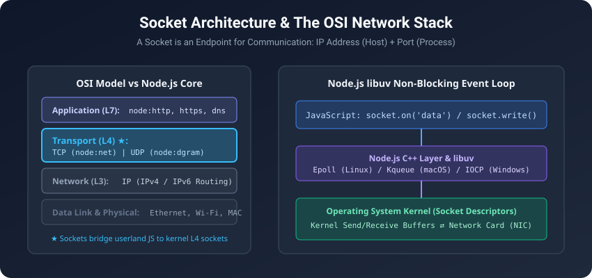
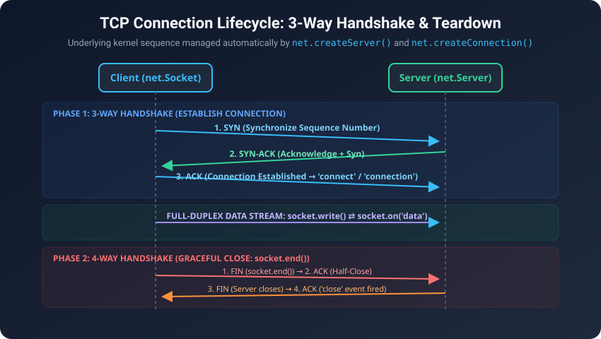
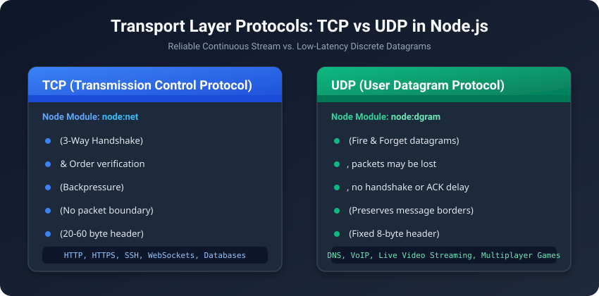
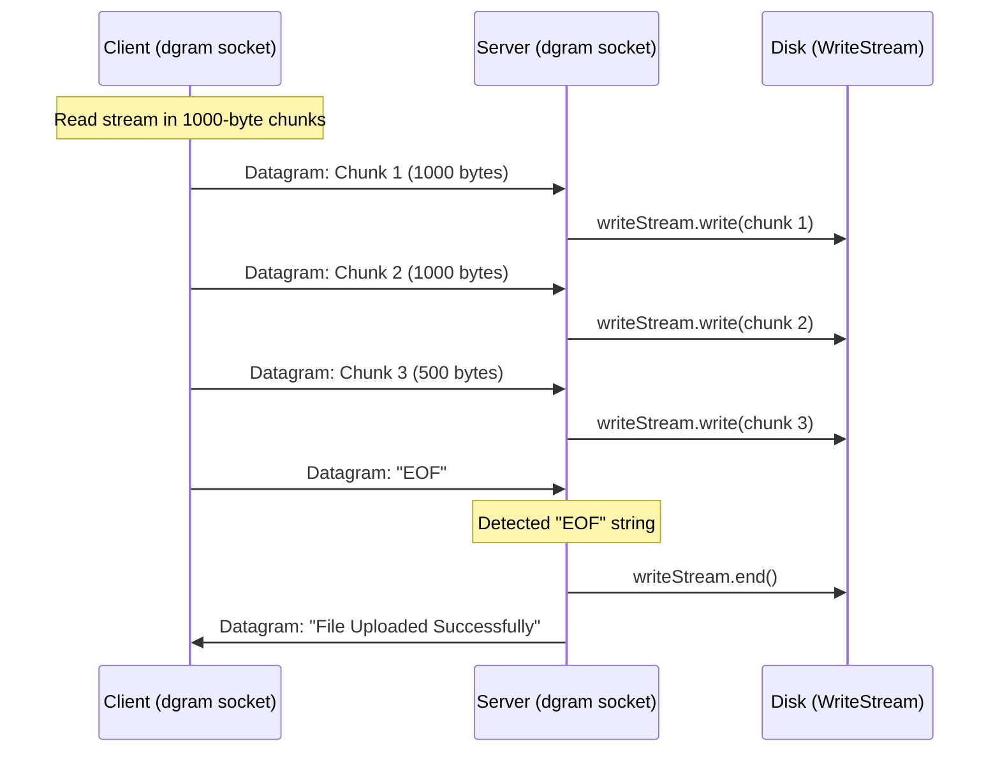

# Node.js Low-Level Networking: TCP & UDP Sockets 🌐


-brightgreen)


A practical, deep-dive guide to **network socket programming in Node.js** using native standard library modules: `node:net` (TCP), `node:dgram` (UDP), and `node:os`.

Built to bridge the gap between high-level web frameworks (Express, NestJS, HTTP) and the low-level transport layer protocols powering the internet.

---

## 📑 Table of Contents
- [1. Networking Architecture & Foundations](#1-networking-architecture--foundations)
- [2. Inspecting Network Interfaces (`node:os`)](#2-inspecting-network-interfaces-nodeos)
- [3. TCP Protocol Deep Dive (`node:net`)](#3-tcp-protocol-deep-dive-nodenet)
  - [The 3-Way Handshake & Connection Lifecycle](#the-3-way-handshake--connection-lifecycle)
  - [TCP Server Implementation](#tcp-server-implementation)
  - [TCP Client Implementation](#tcp-client-implementation)
  - [Line-by-Line Code Breakdown](#line-by-line-code-breakdown-tcp)
- [4. UDP Protocol Deep Dive (`node:dgram`)](#4-udp-protocol-deep-dive-nodedgram)
  - [Datagram Architecture & Characteristics](#datagram-architecture--characteristics)
  - [UDP Server Implementation](#udp-server-implementation)
  - [UDP Client Implementation](#udp-client-implementation)
  - [Chunked File Transfer with EOF Signaling](#chunked-file-transfer-with-eof-signaling)
  - [Line-by-Line Code Breakdown](#line-by-line-code-breakdown-udp)
- [5. Master Comparison: TCP vs UDP](#5-master-comparison-tcp-vs-udp)
- [6. How to Run the Code Locally](#6-how-to-run-the-code-locally)
- [7. Common Pitfalls & Edge Cases](#7-common-pitfalls--edge-cases)
- [8. Top Interview Questions & Answers](#8-top-interview-questions--answers)
- [9. Practice Challenges & Next Steps](#9-practice-challenges--next-steps)

---

## 1. Networking Architecture & Foundations

A **network socket** is an internal software endpoint for sending or receiving data across a computer network. Conceptually, a socket is defined by a unique combination:

$$\text{Socket} = \text{IP Address (Identifies Host)} + \text{Port (Identifies Running Process)}$$



### The OSI Model Context
| OSI Layer | Name | Description | Node.js Module |
|---|---|---|---|
| **Layer 7** | Application | High-level data exchange (HTTP, DNS, WebSockets) | `node:http`, `node:https`, `node:dns` |
| **Layer 4** | **Transport** ★ | **Process-to-process delivery (TCP byte streams, UDP datagrams)** | `node:net`, `node:dgram` |
| **Layer 3** | Network | Host-to-host routing (IP packets) | Managed by OS Kernel |
| **Layer 2/1**| Data Link / Physical | Frames, MAC addresses, Ethernet, Wi-Fi | Hardware Network Interface Card (NIC) |

### How Node.js Handles Network I/O
Node.js does not spawn a new OS thread per socket connection. Instead:
1. It registers socket file descriptors (`fd`) with the OS kernel through **libuv**.
2. On Linux, it uses **epoll**; on macOS, **kqueue**; on Windows, **IOCP**.
3. When network data arrives at the network card, an interrupt notifies the kernel, libuv wakes up the Node.js event loop, and your JavaScript callback (e.g. `socket.on('data')`) fires non-blockingly.

---

## 2. Inspecting Network Interfaces (`node:os`)

Before opening sockets or binding to IP addresses, your application must understand which network interfaces exist on the host machine.

### Code
```javascript
import os from "node:os";

// os.networkInterfaces() returns an object containing network interfaces by name
const networkInterfaces = os.networkInterfaces();
console.log(networkInterfaces);
```

### Explanation
When you call `os.networkInterfaces()`, Node.js queries the OS kernel for all active adapters (Wi-Fi, Ethernet, Loopback, VPN tunnels). The output maps interface names (e.g. `en0`, `lo0`, `eth0`) to arrays of address descriptors:

```javascript
{
  lo0: [ // Loopback adapter (localhost only)
    { address: '127.0.0.1', family: 'IPv4', internal: true, mac: '00:00:00:00:00:00' }
  ],
  en0: [ // Physical Wi-Fi or Ethernet adapter
    { address: '192.168.1.42', family: 'IPv4', internal: false, mac: 'f4:d4:88:5a:21:bb' }
  ]
}
```

#### Key Fields:
- `address`: The assigned IP address.
- `family`: `'IPv4'` or `'IPv6'`.
- `internal`: `true` if loopback (accessible only by the local machine), `false` if routable on your local network (LAN) or internet (WAN).
- `mac`: Hardware Media Access Control address of the network interface card.

---

## 3. TCP Protocol Deep Dive (`node:net`)

**TCP (Transmission Control Protocol)** is a connection-oriented, reliable, stream-based protocol.

### The 3-Way Handshake & Connection Lifecycle



Before a single byte of application data is sent, the client and server kernel perform a **3-Way Handshake**:
1. **SYN**: Client sends a Synchronize packet with an initial sequence number $ISN_C$.
2. **SYN-ACK**: Server acknowledges ($ACK = ISN_C + 1$) and sends its own sequence number $ISN_S$.
3. **ACK**: Client acknowledges ($ACK = ISN_S + 1$). The connection is now `ESTABLISHED`.

#### Graceful Teardown (4-Way Handshake)
When closing via `socket.end()`:
1. Client sends **FIN** (Finish).
2. Server responds with **ACK** (connection is now "half-closed": client won't write, but can still read).
3. Server finishes sending pending data and sends its own **FIN**.
4. Client responds with **ACK**. Socket triggers `'close'`.

---

### TCP Server Implementation
📄 [`Netwoking /TCP SERVER/app.js`](./TCP%20SERVER/app.js)

```javascript
import net from "node:net";

// 1. Create TCP Server instance
const server = net.createServer();

const PORT = 4000;
const HOST = "0.0.0.0"; // Listen on all network interfaces

server.listen(PORT, HOST, () => {
    console.log(`[TCP Server] Listening on ${HOST}:${PORT}`);
});

// 2. Fired when a client completes the 3-Way Handshake
server.on("connection", (socket) => {
    const clientEndpoint = `${socket.remoteAddress}:${socket.remotePort}`;
    console.log(`[TCP Server] Client connected: ${clientEndpoint}`);

    // 3. Fired when data chunks arrive
    socket.on("data", (chunk) => {
        console.log(`[TCP Server] Received from ${clientEndpoint}: "${chunk.toString().trim()}"`);

        // Send a response back to client
        socket.write("Server response: Got your message over TCP!\n");

        // Gracefully close write stream (sends FIN packet)
        socket.end();
    });

    // 4. Socket closed
    socket.on("close", () => {
        console.log(`[TCP Server] Client disconnected: ${clientEndpoint}`);
    });

    socket.on("error", (err) => {
        console.error(`[TCP Server] Socket error on ${clientEndpoint}:`, err.message);
    });
});
```

---

### TCP Client Implementation
📄 [`Netwoking /TCP SERVER/client.js`](./TCP%20SERVER/client.js)

```javascript
import net from "node:net";

const HOST = "127.0.0.1";
const PORT = 4000;

console.log(`[TCP Client] Connecting to ${HOST}:${PORT}...`);

// Initiates TCP connection (initiates SYN packet)
const socket = net.createConnection({ host: HOST, port: PORT });

socket.on("connect", () => {
    console.log("[TCP Client] Connected successfully (3-way handshake complete)!");
    socket.write("Hello from TCP Client!");
});

socket.on("data", (chunk) => {
    console.log("[TCP Client] Received from server:\n", chunk.toString());
});

socket.on("close", () => {
    console.log("[TCP Client] Connection closed.");
});

socket.on("error", (err) => {
    console.error("[TCP Client] Error:", err.message);
});
```

---

### Line-by-Line Code Breakdown (TCP)

#### 1. `net.createServer()`
Creates a `net.Server` instance. Under the hood, this creates a system socket, binds it to an address, and marks it as passive (ready to accept incoming connections).

#### 2. `server.listen(4000, "0.0.0.0")`
- `0.0.0.0` is the wildcard address: it tells the kernel to accept connections on **any** IPv4 interface (localhost `127.0.0.1`, LAN Wi-Fi `192.168.x.x`, etc.).
- Binding to `127.0.0.1` would restrict connections to the local machine only.

#### 3. `server.on("connection", (socket) => { ... })`
Triggered every time a new client connection is established. The `socket` argument is an instance of `net.Socket`, which implements Node's `Duplex Stream` (both Readable and Writable).

#### 4. `socket.on("data", (chunk) => { ... })`
Called whenever a chunk of bytes arrives from the client.
> **Critical Concept**: TCP is a **byte stream**, NOT a message stream! If the client sends two separate `write("Hello")` and `write("World")`, the server may receive them as a single chunk `HelloWorld` or three chunks `Hel`, `loWo`, `rld`. This is called **stream segmentation / framing**.

#### 5. `socket.write(data)` vs `socket.end()`
- `socket.write(data)`: Queues bytes into the socket buffer to be sent to the peer.
- `socket.end()`: Flushes any remaining outgoing data, then sends a TCP `FIN` packet to signal that this end is done sending data.

---

## 4. UDP Protocol Deep Dive (`node:dgram`)

**UDP (User Datagram Protocol)** is a connectionless, lightweight, message-oriented protocol.



### Datagram Architecture & Characteristics
- **No Handshake**: Sockets do not "connect" before sending data. A packet is stamped with a destination IP and Port and sent directly into the network.
- **Message Boundaries Preserved**: If you send 50 bytes in one `socket.send()`, the receiver receives exactly those 50 bytes in one `'message'` event (no concatenation like TCP).
- **No Retransmission or ACK**: If a router drops the packet, it is permanently lost.
- **No Ordering Guarantees**: Packet #2 might arrive before Packet #1.

---

### UDP Server Implementation
📄 [`Netwoking /app.js`](./app.js)

```javascript
import dgram from "node:dgram";

// 1. Create UDP IPv4 socket
const socket = dgram.createSocket("udp4");

// 2. Listen for incoming datagram packets
socket.on("message", (message, remoteAddress) => {
    console.log(`[UDP Server] Received: "${message.toString()}"`);
    console.log(`[UDP Server] From: ${remoteAddress.address}:${remoteAddress.port}`);

    // Send acknowledgment datagram back to sender
    const response = Buffer.from("Message Received Successfully on Server");
    socket.send(response, remoteAddress.port, remoteAddress.address, (err) => {
        if (err) console.error("Error sending response:", err);
    });
});

// 3. Bind socket to port 4000
socket.bind({ port: 4000 }, () => {
    const address = socket.address();
    console.log(`[UDP Server] Listening on ${address.address}:${address.port}`);
});
```

---

### UDP Client Implementation
📄 [`Netwoking /client.js`](./client.js)

```javascript
import dgram from "node:dgram";

const socket = dgram.createSocket("udp4");
const SERVER_HOST = "127.0.0.1";
const SERVER_PORT = 4000;

socket.on("message", (message, remoteAddress) => {
    console.log(`[Client] Server replied: "${message.toString()}"`);
});

const msg = Buffer.from("Hi from Client Laptop!");
socket.send(msg, SERVER_PORT, SERVER_HOST, (err) => {
    if (err) console.error("Send error:", err);
    else console.log(`[Client] Datagram sent to ${SERVER_HOST}:${SERVER_PORT}`);
});
```

---

### Chunked File Transfer with EOF Signaling

Because UDP does not have persistent connections or file streams, transferring a file requires:
1. Breaking the file into chunks that fit within the safe network MTU ($\le 1400$ bytes).
2. Sending each chunk as an independent datagram.
3. Sending a special termination sentinel string (`"EOF"`) to notify the receiver that the stream has ended.



#### Server-side logic:
```javascript
const fileSocket = dgram.createSocket("udp4");
const writeStream = createWriteStream("received_file.mp4");

fileSocket.on("message", (message, remoteAddress) => {
    if (message.toString() === "EOF") {
        console.log("[UDP File Server] Received EOF. File transfer complete!");
        writeStream.end();
        fileSocket.send("File Uploaded Successfully", remoteAddress.port, remoteAddress.address);
    } else {
        writeStream.write(message); // Write raw binary buffer to disk
    }
});

fileSocket.bind({ port: 4001 });
```

---

### Line-by-Line Code Breakdown (UDP)

#### 1. `dgram.createSocket("udp4")`
Creates a `dgram.Socket` instance using the IPv4 protocol. Pass `"udp6"` for IPv6.

#### 2. `socket.bind({ port: 4000 })`
Binds the socket to port 4000 so the OS routes incoming UDP packets destined for port 4000 to this process.
> **Note**: A client does NOT strictly need to call `socket.bind()` before sending! If a client calls `socket.send()`, the operating system automatically assigns a random available ephemeral port.

#### 3. `socket.on("message", (message, remoteAddress) => { ... })`
- `message`: A `Buffer` containing the raw payload bytes of the datagram.
- `remoteAddress`: An object `{ address: '192.168.0.x', family: 'IPv4', port: 51234, size: 24 }` telling you who sent this packet so you can reply.

#### 4. `socket.send(buffer, port, address, callback)`
Sends the payload buffer to the designated destination address and port without establishing a prior connection.

---

## 5. Master Comparison: TCP vs UDP

| Feature | TCP (`node:net`) | UDP (`node:dgram`) |
|---|---|---|
| **Connection Model** | Connection-oriented (Handshake required) | Connectionless (Fire-and-forget) |
| **Reliability** | Guaranteed (ACKs, Retransmission) | Unreliable (No retransmission) |
| **Ordering** | Guaranteed sequence order ($ISN$) | No ordering guarantee |
| **Data Format** | Continuous **Byte Stream** | Discrete **Datagrams** (packets) |
| **Header Size** | 20 – 60 bytes | Fixed 8 bytes |
| **Flow / Congestion Control** | Built-in (Sliding window, backpressure) | None (Userland must manage) |
| **Speed & Latency** | Higher overhead, slight latency | Minimal overhead, real-time speed |
| **Broadcast / Multicast** | No (Unicast point-to-point only) | Yes (`socket.setBroadcast(true)`) |
| **Typical Protocols** | HTTP, HTTPS, SSH, WebSockets, PostgreSQL | DNS, DHCP, WebRTC, VoIP, Game Physics |

---

## 6. How to Run the Code Locally

### 1. Test TCP Server & Client
Open two terminal tabs:

**Terminal 1 (Start TCP Server)**:
```bash
node "Netwoking /TCP SERVER/app.js"
```
*Expected output*: `[TCP Server] Listening on 0.0.0.0:4000`

**Terminal 2 (Start TCP Client)**:
```bash
node "Netwoking /TCP SERVER/client.js"
```
*Expected output*:
- Client connects, prints `[TCP Client] Connected successfully!`
- Server receives message and sends response.
- Client prints response and disconnects gracefully.

---

### 2. Test UDP Server & Client
Open two terminal tabs:

**Terminal 1 (Start UDP Server)**:
```bash
node "Netwoking /app.js"
```
*Expected output*:
- Prints detected network interfaces from `os.networkInterfaces()`.
- Prints `[UDP Server] Listening on 0.0.0.0:4000`.

**Terminal 2 (Start UDP Client)**:
```bash
node "Netwoking /client.js"
```
*Expected output*:
- Sends datagram to `127.0.0.1:4000`.
- Server receives packet, logs payload, and sends back confirmation.

---

## 7. Common Pitfalls & Edge Cases

### 1. The TCP Framing Problem ("Sticky Packets")
**The Issue**: TCP guarantees byte delivery and order, but **NOT message boundaries**.
```javascript
// Client writes 2 messages back-to-back:
socket.write("Hello");
socket.write("World");

// Server might receive:
socket.on("data", (chunk) => {
    // chunk might be "HelloWorld" in a SINGLE event!
});
```
**The Solution**: Use a framing protocol, such as:
- **Delimiter framing**: Append `\n` to messages and split incoming buffers by newline.
- **Length-prefix framing**: Prepend 4 bytes indicating payload length (like HTTP `Content-Length`).

### 2. UDP Maximum Transmission Unit (MTU)
The standard Ethernet MTU is **1500 bytes**. An IP header is 20 bytes and a UDP header is 8 bytes.
- Safe maximum UDP payload: **1472 bytes** (over IPv4).
- If your datagram exceeds 1472 bytes, the IP layer must **fragment** the packet across multiple packets. If a single fragment is lost, the entire datagram is discarded by the receiver!
- **Rule of thumb**: Keep UDP payloads under **1400 bytes** to avoid fragmentation over the internet.

### 3. Port Collisions (`EADDRINUSE`)
If you try to call `socket.bind({ port: 4000 })` or `server.listen(4000)` twice in the same process or when another application is already listening on port 4000, Node.js throws:
```text
Error: listen EADDRINUSE: address already in use 0.0.0.0:4000
```
Always use distinct ports or handle the `'error'` event gracefully.

### 4. Unhandled Socket Errors
If a remote TCP client abruptly terminates (e.g. process killed or cable pulled), the socket receives an `RST` packet. If your `socket` instance does not have an `'error'` listener:
```javascript
socket.on("error", (err) => { ... });
```
Node.js treats unhandled EventEmitter errors as fatal and **terminates your server process**!

---

## 8. Top Interview Questions & Answers

<details>
<summary><b>1. What is the fundamental difference between a stream (TCP) and a datagram (UDP)?</b></summary>

- **TCP is a stream**: Data is a continuous, ordered flow of raw bytes with no boundaries. The receiver cannot infer where one `socket.write()` ends and another begins without an application-level protocol.
- **UDP is a datagram**: Data is sent in discrete, self-contained packets. One `socket.send()` on the sender corresponds to exactly one `socket.on('message')` on the receiver.
</details>

<details>
<summary><b>2. Why does TCP require a 3-Way Handshake instead of a 2-Way Handshake?</b></summary>

A 2-way handshake (Client SYN $\rightarrow$ Server ACK) is vulnerable to old, duplicate SYN packets delayed in the network. A 3-way handshake ensures that:
1. Both client and server agree on each other's initial sequence numbers ($ISN$).
2. Both parties verify that the bidirectional communication channel is functional in both directions before allocating resources and transmitting data.
</details>

<details>
<summary><b>3. What does <code>0.0.0.0</code> mean when binding a server in Node.js?</b></summary>

`0.0.0.0` is the IPv4 **wildcard address**. It tells the operating system to bind the socket to **all available network interfaces** on the host (including loopback `127.0.0.1` and any local area network IPs). If you bind to `127.0.0.1`, external devices on your Wi-Fi/LAN will not be able to connect.
</details>

<details>
<summary><b>4. What is Backpressure in TCP sockets, and how does Node.js handle it?</b></summary>

When a sender writes faster than the network or receiver can consume:
1. `socket.write(chunk)` returns `false` when its internal buffer exceeds `highWaterMark`.
2. The developer should pause reading from the source stream.
3. When the socket's internal buffer drains below the threshold, it emits the `'drain'` event, signaling that it is safe to resume writing.
</details>

<details>
<summary><b>5. Can two applications bind to the exact same port number?</b></summary>

Yes, if they use **different transport protocols** (e.g. one TCP server on port 4000 and one UDP socket on port 4000). The operating system routes packets by `(Protocol, Local IP, Local Port, Remote IP, Remote Port)`. However, two TCP servers cannot bind to the same IP:Port without the `SO_REUSEPORT` kernel socket flag.
</details>

<details>
<summary><b>6. What happens if you send an "EOF" in UDP and that packet gets dropped?</b></summary>

Because UDP does not guarantee packet delivery, if the `"EOF"` packet is dropped by network congestion, the server will never know the transfer completed and will hang waiting for more packets. To make UDP reliable (like QUIC / HTTP/3), application-level acknowledgments and timeout-based retransmission must be implemented.
</details>

<details>
<summary><b>7. How does Node.js achieve high concurrency with TCP sockets on a single thread?</b></summary>

Node.js uses non-blocking I/O multiplexing via **libuv**. The kernel notifies Node.js via system calls (`epoll` on Linux, `kqueue` on macOS) only when a socket has data ready to read or write. Node executes JavaScript callbacks on the main event loop while socket I/O waits in kernel memory buffers.
</details>

---

## 9. Practice Challenges & Next Steps

1. **TCP Chat Room**: Build a multi-client chat room where messages typed by one client are broadcast to all other connected sockets.
2. **Length-Prefixed Framing**: Implement a protocol on top of `net.Socket` where the first 4 bytes of every message indicate the payload size.
3. **Reliable UDP Protocol**: Build a lightweight ACK-based protocol on top of `node:dgram` with a sliding window and packet retransmission.
4. **HTTP Parser on raw TCP**: Create a `net.createServer()` that parses HTTP/1.1 `GET /` requests from a browser and returns `HTTP/1.1 200 OK\r\nContent-Type: text/html\r\n\r\n<h1>Hello!</h1>`.

---

## 📝 License
This project is open-source and available under the [MIT License](../LICENSE).
