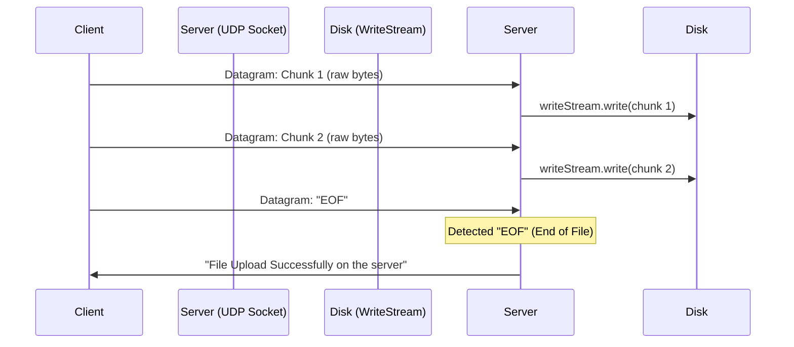

# Networking in Node.js: TCP & UDP Sockets 🌐


A comprehensive, easy-to-understand guide to low-level socket programming in Node.js using native modules (`node:net`, `node:dgram`, and `node:os`).

This guide takes the **exact code** written in this folder and explains every section, heading, and concept with visual diagrams, flowcharts, and interview questions.

---

## 📑 Table of Contents

- [Overview & Architecture](#overview--architecture)
- [Project Structure](#project-structure)
- [1. Inspecting Network Interfaces (`os.networkInterfaces()`)](#1-inspecting-network-interfaces-osnetworkinterfaces)
- [2. UDP Server & Client (`node:dgram`)](#2-udp-server--client-nodedgram)
  - [Section: Creating a UDP Server in Node.js](#section-creating-a-udp-server-in-nodejs)
  - [Section: File Transfer in UDP (Chunk Streaming & EOF)](#section-file-transfer-in-udp-chunk-streaming--eof)
  - [UDP Client Code & Flow](#udp-client-code--flow)
- [3. TCP Server & Client (`node:net`)](#3-tcp-server--client-nodenet)
  - [The 3-Way Handshake & Connection Flow](#the-3-way-handshake--connection-flow)
  - [TCP Server Code Explained](#tcp-server-code-explained)
  - [TCP Client Code Explained](#tcp-client-code-explained)
- [4. TCP vs UDP: Quick Reference Matrix](#4-tcp-vs-udp-quick-reference-matrix)
- [5. Interview Questions & Fast Revision](#5-interview-questions--fast-revision)

---

## Overview & Architecture

A **socket** is an endpoint that lets two programs send data to each other across a network:

$$\text{Socket} = \text{IP Address (which machine)} + \text{Port (which program on that machine)}$$


- **Layer 4 (Transport)**: Handles data delivery between processes. In Node.js, this is done via:
  - `node:net` $\rightarrow$ **TCP** (connection-oriented, reliable stream)
  - `node:dgram` $\rightarrow$ **UDP** (connectionless, fast datagrams)
- **Layer 7 (Application)**: Protocols built on top of Layer 4 like `node:http`, `node:https`, and `node:dns`.

---

## Project Structure

```plaintext
Netwoking /
├── app.js            # UDP Server & UDP File Transfer
├── client.js         # UDP Client (sending message & streaming chunks with EOF)
├── TCP SERVER/
│   ├── app.js        # TCP Server (net.createServer)
│   └── client.js     # TCP Client (net.createConnection)
├── assets/           # Visual diagrams (SVGs)
└── README.md         # This documentation
```

---

## 1. Inspecting Network Interfaces (`os.networkInterfaces()`)

In [`app.js`](./app.js), the script begins with:

```js
import os from 'node:os';
const networkInterface = os.networkInterfaces();
console.log(networkInterface);
```

### What This Does:
`os.networkInterfaces()` queries the operating system for all network cards (NICs) on your computer (Wi-Fi, Ethernet, Loopback, VPN).

It outputs an object where each key is an interface name:
- `lo0` / `lo`: The **loopback interface** (`127.0.0.1` / `localhost`). Used for communication strictly within the same computer.
- `en0` / `eth0`: Your physical **Wi-Fi or Ethernet adapter** (e.g. `192.168.0.105`). Used to communicate with other devices on your home or office Wi-Fi.

---

## 2. UDP Server & Client (`node:dgram`)


**UDP (User Datagram Protocol)** is **connectionless**:
- No handshake is needed before sending data.
- Packets are called **datagrams**.
- If a packet is lost in transit, it is not re-sent (fast, low-latency, but unreliable).

---

### Section: Creating a UDP Server in Node.js

From [`app.js`](./app.js):

```js
// Creating a UDP server in NODEJS
const socket = dgram.createSocket("udp4");
console.log(socket);

socket.on('message', (message, remoteAddress) => {
    console.log(message.toString());
    console.log(remoteAddress);
    
    socket.send('Message Received Successfully');
});

socket.bind({ port: 4000 }, () => {
    console.log(socket.address());
    console.log(`listening on port ${socket.address().port}`);
});
```

#### Explanation:
1. `dgram.createSocket("udp4")`: Creates an IPv4 UDP socket.
2. `socket.bind({ port: 4000 })`: Binds this socket to port `4000` so the OS directs incoming UDP packets on port 4000 to this program.
3. `socket.on('message', (message, remoteAddress) => { ... })`:
   - Fires whenever a datagram arrives.
   - `message` is a `Buffer` containing the raw bytes. We call `.toString()` to view it as text.
   - `remoteAddress` tells you the sender's IP and port (e.g. `{ address: '192.168.0.105', port: 51234 }`).
4. `socket.send(...)`: Sends a response datagram back to the sender.

---

### Section: File Transfer in UDP (Chunk Streaming & EOF)

From [`app.js`](./app.js):

```js
// File transfer in UDP
const writeStream = createWriteStream("numbers.mp4");

socket.on("message", async (message, remoteAddress) => {
    if (message.toString() === "EOF") {
        socket.send(
            "File Upload Successfully on the server",
            remoteAddress.port,
            remoteAddress.address
        );
    } else {
        writeStream.write(message);
    }
});
```



#### Explanation:
- Because UDP has **no persistent stream connection**, a large file cannot be piped continuously in one go.
- Instead, the sender slices the file into small chunks and sends each chunk as a datagram.
- The server writes incoming chunks directly to disk using `writeStream.write(message)`.
- When the sender finishes, it sends a special string message: `"EOF"` (End of File). The server sees `"EOF"` and knows the transfer is complete.

---

### UDP Client Code & Flow

From [`client.js`](./client.js):

```js
import dgram from "node:dgram";
import { createReadStream } from "node:fs";

const socket = dgram.createSocket("udp4");

// 1. Send simple message
socket.on("message", (message, remoteAddress) => {
    console.log(message.toString());
    console.log(remoteAddress);
});
socket.send("Hi from Lap", 4000, "192.168.87.41");

// 2. Stream a file in 1000-byte chunks
const readStream = createReadStream("path", { highWaterMark: 1000 });

readStream.on("data", (chunk) => {
    socket.send(chunk, 4000, "192.168.0.105");
});

readStream.on("end", () => {
    socket.send("EOF", 4000, "192.168.0.105", () => {
        console.log("message sent");
    });
});
```

#### Explanation:
- `highWaterMark: 1000`: Reads the file in small 1000-byte chunks so each packet stays well below the standard network MTU (1500 bytes), avoiding fragmentation.
- When `readStream` emits `'end'`, the client sends `"EOF"` to signal completion.

---

## 3. TCP Server & Client (`node:net`)


**TCP (Transmission Control Protocol)** is **connection-oriented**:
1. It establishes a connection via a **3-Way Handshake** (`SYN` $\rightarrow$ `SYN-ACK` $\rightarrow$ `ACK`).
2. It guarantees **order and delivery** (lost packets are automatically re-sent by the OS).
3. It closes gracefully via a **4-Way Handshake** (`FIN` $\rightarrow$ `ACK`).

---

### TCP Server Code Explained

From [`TCP SERVER/app.js`](./TCP%20SERVER/app.js):

```js
import net from "node:net";

const server = net.createServer();

server.listen(4000, "0.0.0.0", () => {
    console.log("Server stated on port 4000");
});

server.on("connection", (socket) => {
    socket.on("data", (chunk) => {
        console.log(chunk.toString());
        socket.write("HTTP\n\nGot Your Message");
        socket.end();
    });

    socket.on("close", () => {
        console.log(socket.remoteAddress, " : Client disconnected");
    });

    console.log("client Connected", socket.remoteAddress);
});
```

#### Step-by-Step Breakdown:
1. `net.createServer()`: Creates a TCP server.
2. `server.listen(4000, "0.0.0.0")`: Binds to port `4000`. `"0.0.0.0"` tells the OS to listen on **all** local network interfaces (Wi-Fi, Ethernet, and localhost).
3. `server.on("connection", (socket) => { ... })`: Runs whenever a client connects. The `socket` object represents the 2-way stream with that client.
4. `socket.on("data", (chunk) => { ... })`: Runs when data arrives from the client.
5. `socket.write(...)`: Sends data back to the client.
6. `socket.end()`: Sends a `FIN` packet to gracefully close the connection.
7. `socket.on("close", () => { ... })`: Runs when the connection has fully closed.

---

### TCP Client Code Explained

From [`TCP SERVER/client.js`](./TCP%20SERVER/client.js):

```js
import net from "node:net";

const socket = net.createConnection({ host: "192.168.0.105", port: 4000 });

setTimeout(() => {
    socket.write("hi");
}, 2000);

socket.on("data", (chunk) => {
    console.log(chunk.toString());
});
```

#### Step-by-Step Breakdown:
1. `net.createConnection({ host, port })`: Initiates the TCP connection to the server.
2. `setTimeout(..., 2000)`: Waits 2 seconds, then sends the string `"hi"` using `socket.write("hi")`.
3. `socket.on("data", (chunk) => { ... })`: Receives and prints the server's reply (`"HTTP\n\nGot Your Message"`).

---

## 4. TCP vs UDP: Quick Reference Matrix

| Feature | TCP (`node:net`) | UDP (`node:dgram`) |
|---|---|---|
| **Connection** | Connection-oriented (Handshake required) | Connectionless (No handshake) |
| **Reliability** | Guaranteed (lost packets re-sent) | Not guaranteed (packets can be dropped) |
| **Ordering** | Guaranteed in exact order | Packets may arrive out of order |
| **Data Nature** | Continuous Byte Stream | Discrete Datagrams (Packets) |
| **Header Size** | 20 – 60 bytes | 8 bytes (lightweight) |
| **Best Used For** | Web (HTTP/HTTPS), File transfers, SSH, Databases | Live video streaming, DNS, VoIP, Multiplayer gaming |

---

## 5. Interview Questions & Fast Revision

<details>
<summary><b>1. What is the difference between TCP and UDP?</b></summary>

TCP is connection-oriented, reliable, and guarantees the order of delivery using acknowledgments and retransmissions. UDP is connectionless, does not guarantee delivery or ordering, but has lower latency and smaller header overhead (8 bytes vs 20+ bytes).
</details>

<details>
<summary><b>2. Why is an "EOF" message used in the UDP file transfer code?</b></summary>

Because UDP has no persistent connection or built-in stream termination, the server has no way of knowing when the client has finished sending chunks. Sending an agreed-upon sentinel value like `"EOF"` tells the server to close the write stream.
</details>

<details>
<summary><b>3. What does <code>0.0.0.0</code> mean in <code>server.listen(4000, "0.0.0.0")</code>?</b></summary>

`0.0.0.0` is the wildcard address. It tells the server to listen on all IPv4 network interfaces on the machine (both `127.0.0.1` and your machine's LAN IP such as `192.168.x.x`). If you bind to `127.0.0.1`, only programs running on the same computer can connect.
</details>

<details>
<summary><b>4. What is the difference between <code>socket.write()</code> and <code>socket.end()</code> in TCP?</b></summary>

`socket.write()` sends data while keeping the socket open for more writes. `socket.end()` sends the provided data (if any) and then sends a `FIN` packet to signal that this side is done writing data.
</details>

<details>
<summary><b>5. Why do we set <code>highWaterMark: 1000</code> when streaming over UDP?</b></summary>

Standard Ethernet has an MTU (Maximum Transmission Unit) of 1500 bytes. An IP header is 20 bytes and a UDP header is 8 bytes. Keeping the chunk size around 1000 bytes ensures that each datagram fits comfortably within a single network frame without triggering IP packet fragmentation.
</details>

---

## 📝 License
This project is open-source and available under the [MIT License](../LICENSE).
